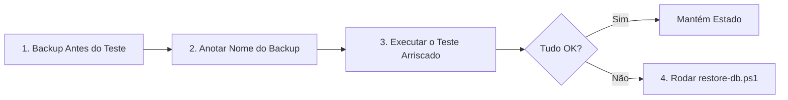

# 🛡️ Ambiente de Testes e Estratégia de Segurança do Banco de Dados

Este documento define o fluxo operacional para realizar testes, sincronização e alterações no banco único do **Colmeia Digital** no Supabase com total segurança e capacidade de rollback imediato.

---

## 1. Visão Geral da Arquitetura

- **Banco Único:** O projeto utiliza uma instância no Supabase.
- **Segurança de Dados:** Baseada em dumps SQL com `pg_dump` e restauração transacional com `psql`.
- **Visibilidade:** Ao iniciar a aplicação com `npm run dev`, o backend informa explicitamente no terminal o host e a base de dados em uso:
  ```text
  [database] Conectado ao banco: postgresql://aws-0-sa-east-1.pooler.supabase.com:5432/postgres
  [colmeia-digital-backend] running on port 4000
  ```

---

## 2. Checklist de Segurança Antes de Testes Arriscados

Sempre que você for testar operações críticas como:
- Sincronização offline/online (sync) entre mobile e backend;
- Exclusão em massa ou limpeza de cadastros;
- Alterações em massa de status de caixas ou apiários;
- Migrations de schema estruturais;

Siga rigorosamente o ciclo de 4 etapas:



### Passo a Passo Operacional:

1. **Gere o backup antes de começar:**
   ```powershell
   .\scripts\backup-db.ps1
   ```
2. **Anote o nome do arquivo gerado exibido no terminal** (ex: `backup_2026-09-29_1530.sql`).
3. **Execute seus testes no aplicativo ou backend.**
4. **Se algo der errado (duplicação, inconsistência, corrupção de dados):**
   ```powershell
   .\scripts\restore-db.ps1
   ```
   - Escolha o número do backup anotado no Passo 2.
   - Digite `SIM` para confirmar.
   - O script criará automaticamente um backup de emergência do estado com erro antes de restaurar o backup original limpo.

---

## 3. Como Confirmar Rapidamente que o Restore Funcionou

Para validar o estado do banco antes e depois do restore:

### Opção A: Usar o Prisma Studio (Interface Visual)
Abra a interface gráfica do Prisma para inspecionar as tabelas:
```powershell
npx prisma studio
```
Navegue em `User`, `Apiary`, `Box`, `ReviewReport` e `Manejo` para conferir a contagem e os registros.

### Opção B: Verificação Rápida via Terminal (Script Dedicado)
Execute diretamente:
```powershell
npm run check-db
```
*(Ele executa a contagem consolidada de todas as tabelas: users, apiaries, boxes, review_reports, manejos, sessions, notifications).*

---

## 4. Base de Dados Conhecida (Seed de Testes)

Para testes do dia a dia e desenvolvimento previsível, existe um seed com dados conhecidos:

### Credenciais do Usuário de Teste:
- **E-mail:** `teste@colmeiadigital.com`
- **Senha:** `Senha123!`
- **Nome:** `Apicultor Teste`

### Estrutura Populada pelo Seed:
- **2 Apiários:**
  - `Apiário Vale das Flores` (2 caixas)
  - `Apiário Morro do Sol` (1 caixa)
- **3 Caixas:**
  - `Caixa 01 - Rainha Alfa`
  - `Caixa 02 - Núcleo Jovem`
  - `Caixa 03 - Forte`
- **1 Revisão Completa:** Registrada para a Caixa 01.
- **1 Manejo:** Tipo *Alimentação* associado à revisão da Caixa 01.
- **1 Notificação de Boas-Vindas.**

### Como Rodar o Seed:
- **Apenas popular/redefinir os dados de teste:**
  ```powershell
  npm run seed
  # ou: npx prisma db seed
  ```
- **Se quiser resetar o banco inteiro do zero (apaga tudo e recria):**
  ```powershell
  npx prisma migrate reset
  ```
  *(O `prisma migrate reset` já executa o `prisma/seed.ts` automaticamente ao finalizar).*

---

## 5. Resumo dos Comandos Úteis

| Ação | Comando |
|---|---|
| Fazer backup completo | `.\scripts\backup-db.ps1` |
| Restaurar backup anterior | `.\scripts\restore-db.ps1` |
| Popular dados conhecidos de teste | `npm run seed` |
| Abrir painel visual do banco | `npx prisma studio` |
| Iniciar backend com log de conexão | `npm run dev` |
